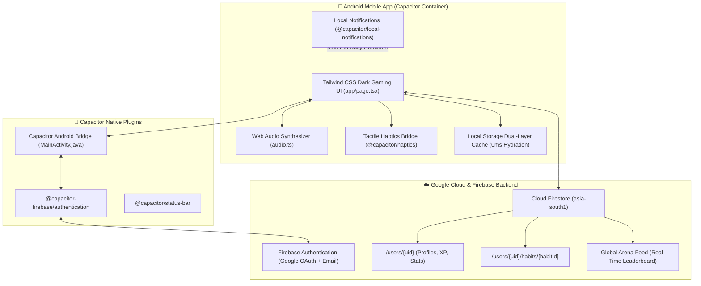
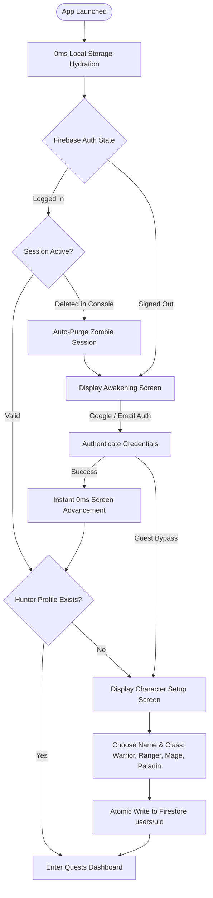
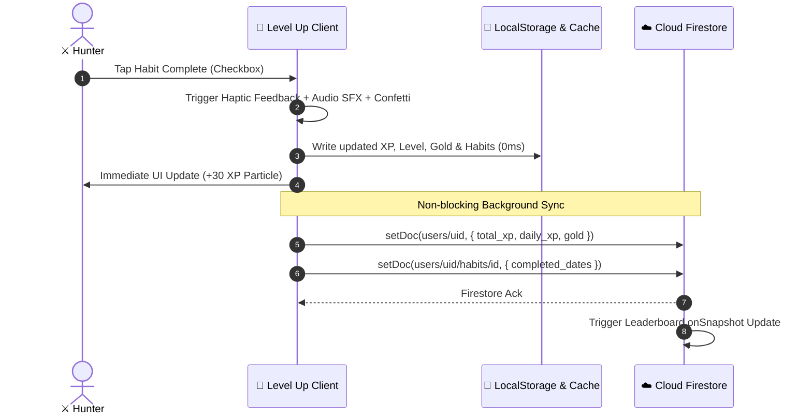
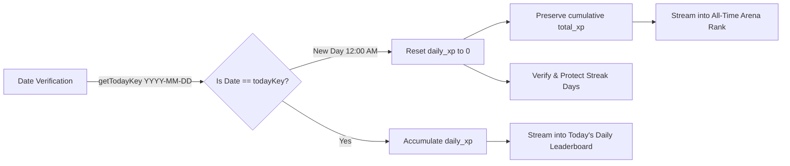

# ⚔️ LEVEL UP — Gamified RPG Habit Tracker

[](https://github.com/nomadlover/level-up-habit-tracker/raw/main/release/app-debug.apk)
[](https://nextjs.org/)
[](https://capacitorjs.com/)
[](https://firebase.google.com/)
[](LICENSE)

> **Gamify your discipline.** Turn your daily habits and goals into high-stakes RPG quests. Slay procrastination, level up your hunter class, maintain streaks, and dominate the Global Arena Leaderboard.

---

## 📲 Download Release APK

| Artifact | Version | Size | Direct Download |
|:---|:---:|:---:|:---:|
| **LEVEL UP Android App** | `v1.0.0 (Release)` | `~8.5 MB` | [📥 **Download app-debug.apk**](https://github.com/nomadlover/level-up-habit-tracker/raw/main/release/app-debug.apk) |

### Quick Installation:
1. Download [`release/app-debug.apk`](release/app-debug.apk) directly to your Android device.
2. Tap the downloaded file to install (allow *"Install unknown apps"* if prompted).
3. Sign in with Google or Email/Password, awaken your Hunter, and embark on your quests!

---

## 🏗️ System Architecture

The application is built on a hybrid architecture combining a high-performance **Next.js 16** responsive client inside an **Android Capacitor 8** native runtime container, backed by **Google Cloud Firestore** and **Firebase Authentication**.



---

## 🔄 User Authentication & Character Awakening Flow

New and returning operatives undergo a zero-friction onboarding flow with automatic session healing, fail-safe watchdogs, and immediate screen transitions:



---

## ⚡ Dual-Layer Persistence & Real-Time Sync Lifecycle

Every quest action triggers an **instant local update** (0ms latency with audio/haptic feedback) followed by a **background Cloud Firestore synchronization**:



---

## 🕛 Automatic 12:00 AM Midnight Reset & Arena Ranking

The Daily Arena dynamically tracks high-performing hunters without burning database quotas:



---

## 🎮 Game Mechanics & RPG Progression

### 1. Hunter Classes & Archetypes
Operatives select their identity upon awakening:
* **⚔️ Warrior / Paladin**: Frontline discipline, armor against procrastination.
* **🏹 Ranger / Archer**: Swift, consistent daily task executions.
* **🪄 Mage / Sorcerer**: Deep-work mastery, knowledge and study spells.
* **🛡️ Guardian**: Defensive consistency, bulletproof streak shields.

### 2. Level Progression Formula
Player level escalates exponentially with total earned XP:
$$\text{XP Required for Level } n = \text{round}\left(100 \times 1.25^{n - 1}\right)$$

### 3. Quest Difficulty Rewards
| Quest Difficulty | XP Reward | Gold Reward | Use Case |
|:---|:---:|:---:|:---|
| **🟢 Easy** | `+15 XP` | `🪙 5 Gold` | Quick wins (Drink water, make bed) |
| **🟡 Medium** | `+30 XP` | `🪙 10 Gold` | Standard habits (30m workout, read 10 pages) |
| **🟠 Hard** | `+60 XP` | `🪙 20 Gold` | High effort (2h deep study, coding project) |
| **🔴 Epic** | `+120 XP` | `🪙 40 Gold` | Breakthrough milestones (Exam completion, major launch) |

### 4. Streak Protection & Daily Reminders
* **Daily Streak**: Increments automatically when at least 1 quest is completed today and yesterday was maintained.
* **9:00 PM Protection**: Scheduled native notification triggers at 21:00 local time if quests remain unfinished before midnight.

### 5. Loot Shop & Treasury
Spend earned gold on custom and default rewards:
* Cheat meal / specialty coffee
* Movie or anime binge night
* Power nap or custom gaming sessions

---

## 📂 Repository Structure

```
level-up-habit-tracker/
├── android/                        # Capacitor Android native project
│   ├── app/
│   │   ├── google-services.json    # Firebase Android configuration
│   │   └── src/main/AndroidManifest.xml
│   └── build.gradle                # Android Gradle build scripts
├── app/                            # Next.js 16 source code
│   ├── constants/                  # App links, versioning, links.ts
│   ├── utils/
│   │   ├── audio.ts                # Synthesized Web Audio sound effects
│   │   ├── firebase.ts             # Firebase Auth & Firestore client setup
│   │   └── native.ts               # Capacitor Haptics & Notification bridges
│   ├── globals.css                 # Custom gaming dark theme
│   ├── layout.tsx                  # Root metadata & fonts
│   └── page.tsx                    # Main single-page application & Arena UI
├── release/                        # Compiled distribution binaries
│   └── app-debug.apk               # Ready-to-install Android APK (~8.5 MB)
├── capacitor.config.json           # Native bridge configuration
├── firebase.json                   # Firebase Auth & Firestore rules configuration
├── firestore.indexes.json          # Database query indexes
├── firestore.rules                 # Strict security rules (public read, owner write)
├── package.json                    # Dependencies and scripts
└── tsconfig.json                   # TypeScript configuration
```

---

## 🛡️ Cloud Firestore Security Rules

Cloud Firestore is protected by declarative security rules allowing public read access for the Global Arena Leaderboard while strictly restricting all document writes to authenticated owners:

```javascript
rules_version = '2';
service cloud.firestore {
  match /databases/{database}/documents {
    match /users/{userId} {
      // Allow read so the Global Leaderboard works seamlessly across all auth states
      allow read: if true;
      // Strictly restrict write operations to the authenticated document owner
      allow write: if request.auth != null && request.auth.uid == userId;
      
      // Habits and custom rewards subcollections
      match /{allSubcollections=**} {
        allow read, write: if request.auth != null && request.auth.uid == userId;
      }
    }
  }
}
```

---

## 💻 Local Development & Build Setup

### Prerequisites
* **Node.js**: v18.0 or higher
* **Java SDK**: OpenJDK 17 or 21
* **Android Studio / SDK**: Android SDK Platform 34+

### 1. Clone & Install Dependencies
```bash
git clone https://github.com/nomadlover/level-up-habit-tracker.git
cd level-up-habit-tracker
npm install
```

### 2. Run Local Web Development Server
```bash
npm run dev
# Open http://localhost:3000
```

### 3. Build & Sync Native Android Assets
```bash
# 1. Compile Next.js static build
npm run build

# 2. Sync web assets into Android Capacitor container
npx cap sync android
```

### 4. Compile Android APK
```bash
# Windows
cd android
.\gradlew.bat assembleDebug

# macOS / Linux
cd android
./gradlew assembleDebug
```
The output APK is generated at:
`android/app/build/outputs/apk/debug/app-debug.apk`

---

## 📜 License

This project is licensed under the **MIT License**. Feel free to use, modify, and distribute.
